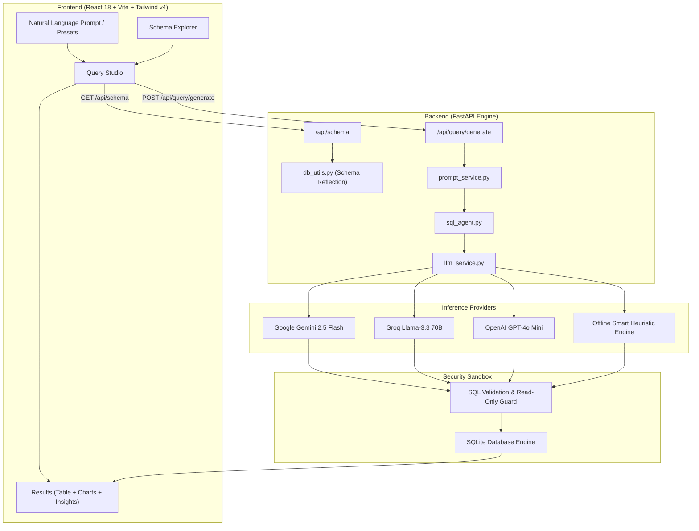

<div align="center">

# ⚡ SQLAgent Pro

### Autonomous Natural Language to SQL Analytics Studio & Database Copilot

[](https://github.com/shakyasagar166/SQLAgent-Pro)
[](https://python.org)
[](https://fastapi.tiangolo.com)
[](https://react.dev)
[](https://vitejs.dev)
[](https://tailwindcss.com)
[](https://ai.google.dev)
[](https://opensource.org/licenses/MIT)

<p align="center">
  <b>SQLAgent Pro</b> is an enterprise-ready AI Analytics Studio that enables non-technical business stakeholders, engineers, and data teams to interact with relational databases using plain natural language. Built with <b>FastAPI</b>, <b>React 18</b>, <b>SQLite/PostgreSQL</b>, and <b>Google Gemini / Groq / OpenAI</b>.
</p>

[Key Features](#-key-features) • [System Architecture](#-system-architecture) • [Quick Start](#-quick-start) • [API Documentation](#-api-reference)

</div>

---

## 🌟 Key Features

<table>
  <tr>
    <td width="50%">
      <h3>💬 Natural Language to SQL</h3>
      <p>Ask complex questions in English or business terminology. SQLAgent Pro automatically synthesizes optimal queries with proper JOINs, aggregations, and filters.</p>
    </td>
    <td width="50%">
      <h3>🛡️ Read-Only Security Sandbox</h3>
      <p>Strictly enforces read-only operations. Malicious or accidental destructive queries (<code>DROP</code>, <code>DELETE</code>, <code>UPDATE</code>, <code>ALTER</code>) are blocked before reaching the database engine.</p>
    </td>
  </tr>
  <tr>
    <td width="50%">
      <h3>📊 Instant Visual Charts</h3>
      <p>Automatically recommends and renders dynamic SVG bar charts, line graphs, and category breakdowns directly from query result sets.</p>
    </td>
    <td width="50%">
      <h3>📑 Interactive Schema Explorer</h3>
      <p>Browse database tables, column types, primary keys, and sample records in real-time to formulate sharper questions.</p>
    </td>
  </tr>
  <tr>
    <td width="50%">
      <h3>💡 Executive Business Takeaways</h3>
      <p>Delivers natural language business insights and executive summaries explaining the "so what" behind the raw numerical results.</p>
    </td>
    <td width="50%">
      <h3>⚡ Multi-Provider & Offline Fallback</h3>
      <p>Seamlessly switch between <b>Google Gemini 2.5 Flash</b>, <b>Groq (Llama-3.3 70B)</b>, <b>OpenAI (GPT-4o)</b>, or run offline via the built-in <b>Smart Heuristic Engine</b>.</p>
    </td>
  </tr>
</table>

---

## 🏛️ System Architecture



---

## 📂 Repository File Structure

```text
SQLAgent-Pro/
│
├── backend/
│   ├── app/
│   │   ├── main.py                     # FastAPI server, CORS middleware & health check
│   │   │
│   │   ├── routes/
│   │   │   ├── query.py                # SQL generation & raw execution endpoints
│   │   │   └── schema.py               # Database reflection endpoints
│   │   │
│   │   ├── services/
│   │   │   ├── llm_service.py          # Gemini / Groq / OpenAI & heuristic fallback
│   │   │   ├── sql_agent.py            # Autonomous query coordinator & guardrails
│   │   │   └── prompt_service.py       # Prompt template loader & schema injector
│   │   │
│   │   ├── models/
│   │   │   └── schemas.py              # Pydantic data schemas & response contracts
│   │   │
│   │   └── utils/
│   │       └── db_utils.py             # SQLite inspection, safe execution & seeding
│   │
│   ├── requirements.txt                # Python backend dependencies
│   └── .env.example                    # Environment keys (Gemini, Groq, OpenAI)
│
├── frontend/
│   ├── src/
│   │   ├── components/
│   │   │   ├── SchemaViewer.jsx        # Interactive database schema explorer
│   │   │   ├── QueryInput.jsx          # Prompt input, presets & model switcher
│   │   │   └── QueryResult.jsx         # Table view, visual charts, SQL & insights
│   │   │
│   │   ├── pages/
│   │   │   └── Home.jsx                # Studio layout & analytics coordination
│   │   │
│   │   ├── App.jsx                     # Top navbar, DB connection monitor & footer
│   │   ├── index.css                   # Dark mesh glow & Tailwind v4 styling
│   │   └── main.jsx                    # React 18 root
│   │
│   ├── package.json                    # React, Vite, Tailwind v4, Lucide Icons
│   └── README.md                       # Frontend documentation
│
├── data/
│   └── sample_database.db             # Pre-seeded SQLite database (customers, products, orders)
│
├── prompts/
│   └── sql_generation.txt              # Production Text-to-SQL system prompt
│
├── run_backend.bat                     # 1-Click Windows Backend Launcher (Port 8001)
├── run_frontend.bat                    # 1-Click Windows Frontend Launcher (Port 5174)
├── push_to_github.bat                  # 1-Click GitHub Push Script
├── .gitignore                          # Clean git ignore rules (.env, node_modules, etc.)
├── README.md                           # Master GitHub documentation
└── LICENSE                             # MIT License
```

---

## 🚀 Quick Start

### 1. Backend Setup

```bash
cd backend

# Create and activate virtual environment
python -m venv venv
.\venv\Scripts\activate   # On Windows
# source venv/bin/activate # On macOS/Linux

# Install dependencies
pip install -r requirements.txt

# Configure environment variables
copy .env.example .env    # On Windows
# cp .env.example .env    # On macOS/Linux
```

Configure `backend/.env` (optional — works out of the box with the offline heuristic engine):
```env
LLM_PROVIDER=gemini
GEMINI_API_KEY=your_gemini_api_key_here
GEMINI_MODEL=gemini-2.5-flash
PORT=8001
```

Start the backend:
```bash
python -m uvicorn app.main:app --reload --port 8001
```
- API Docs: **`http://localhost:8001/docs`**

---

### 2. Frontend Setup

In a new terminal:
```bash
cd frontend
npm install
npm run dev
```
Open **`http://localhost:5174`** in your browser.

---

### ⚡ 1-Click Windows Launchers

Double-click the batch files in the root folder:
- `run_backend.bat` ➔ Starts FastAPI server on port `8001`
- `run_frontend.bat` ➔ Starts Vite React studio on port `5174`
- `push_to_github.bat` ➔ 1-Click Git push to your repository

---

## 📡 API Reference

| Method | Endpoint | Description |
| :--- | :--- | :--- |
| `GET` | `/api/schema` | Inspect tables, column types, row counts, and sample records |
| `POST` | `/api/query/generate` | Synthesize SQL from plain English, execute safely, and return insights |
| `POST` | `/api/query/execute-raw`| Execute custom validated SELECT queries in read-only sandbox |
| `GET` | `/api/query/presets` | Retrieve curated sample business questions |
| `GET` | `/health` | Server health check, active LLM status, and DB connection probe |

---

## 📄 License

Distributed under the MIT License. See [`LICENSE`](LICENSE) for details.
